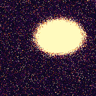
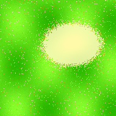
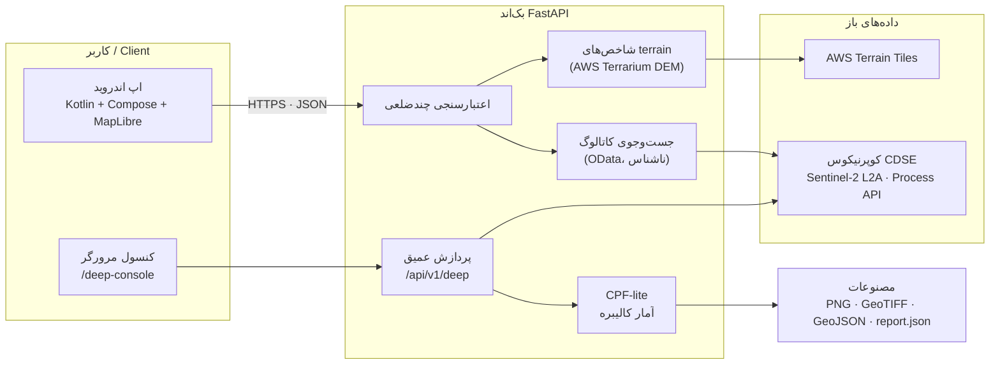

<div align="center">

# 🛰️ SubsurfaceExplorer — Sal-Subsurf

**ایستگاه کاری مکانیِ آگاه-از-شواهد برای آشکارسازی بی‌هنجاری‌های سطحی از تصاویر رایگان Sentinel-2**
**An evidence-aware geospatial workspace for surface-anomaly detection from free Sentinel-2 imagery**

`Android (Kotlin + Compose + MapLibre)` · `FastAPI (Python)` · `Copernicus CDSE` · `آشکارسازی آماری کالیبره CPF-lite`


-green)


**[🇮🇷 فارسی](#persian) · [🇬🇧 English](#english) · [📝 گزارش آپدیت بزرگ v1.3.0 / v1.3.0 Update Report](docs/UPDATE-REPORT-v1.3.0.md) · [تاریخچهٔ تغییرات / CHANGELOG](CHANGELOG.md)**

**🆕 v1.4.0 — بازطراحی حرفه‌ای رابط کاربری اندروید / Professional Android UI overhaul — [جزئیات / details](CHANGELOG.md)**

</div>

---

<a id="persian"></a>
<div dir="rtl">

## 🇮🇷 معرفی پروژه

**Sal-Subsurf (SubsurfaceExplorer)** یک سامانهٔ متن‌باز سه‌لایه است: یک اپ اندروید برای ترسیم ناحیهٔ پیمایش روی نقشهٔ تعاملی، یک بک‌اند FastAPI برای پردازش داده‌های ماهواره‌ای و زمینی، و یک خط لولهٔ «پردازش عمیق» که پیکسل‌های واقعی Sentinel-2 L2A را از **کوپرنیکوس دیتا اسپیس (CDSE)** می‌گیرد و با آمار کالیبره، بی‌هنجاری‌های **سطحی** را آشکار می‌کند — رطوبت غیرعادی خاک، اختلال پوشش گیاهی، تغییرات رطوبت/خاک‌لختگی و پایداری زمانی آن‌ها در طول ماه‌ها.

> ⚠️ **صداقت علمی، اول از همه:** این پروژه «گنج‌یاب» و «اسکنر زیرزمینی» **نیست**. سنجندهٔ نوری زیر سطح زمین را نمی‌بیند و هیچ تخمین عمق یا طبقه‌بندی هدف دفن‌شده‌ای ارائه نمی‌دهد. خروجی این ابزار، «شاخص سطحی با منشأ کامل و معناداری آماری» است — یک ابزار **اولویت‌بندی پیمایش میدانی**، نه اثبات وجود هدف.

### ویژگی‌های کلیدی

- 🗺️ **اپ اندروید بومی** — Kotlin 2.2، Jetpack Compose (Material 3)، MapLibre Native 11؛ ترسیم ناحیهٔ ۳ تا ۱۰ رأسی با مساحت ژئودزیک زنده، اعتبارسنجی آفلاین، تنظیم آدرس سرور در زمان اجرا، رابط فارسی/RTL.
- 🛰️ **پردازش عمیق Sentinel-2** — دانلود پیکسلی ۸ کاناله (B02/B03/B04/B08/B11/B12/SCL/dataMask) از Process API، ماسک ابر SCL، ۷ شاخص طیفی (NDVI، NDWI، MNDWI، NDMI، NBR، BSI، آلبدو)، آمار مقاوم چندزمانی (z-score با median/MAD، پایداری، روند Theil–Sen).
- 🧠 **موتور آماری CPF-lite (v1.3.0، حالت پیش‌فرض)** — روندزدایی مقاوم زمینه، سفیدسازی کوواریانس، مقیاس‌بندی null تجربی، سوروگایت فاز-تصادفی و **p-value کانفورمال add-1**؛ آشکارسازی فقط وقتی معنادار است که p ≤ alpha.
- 🧩 **کاشی‌کاری بومی ۱۰ متر (v1.3.0)** — تحلیل روی گرید بومی سنتینل-۲ به‌جای کوچک‌سازی به ۵۱۲ پیکسل؛ تایل‌های ≤۵۱۲px با هالهٔ ۲۴px، دوخت سراسری و بودجهٔ تا ≈۲۰/۵×۲۰/۵ کیلومتر.
- 🏔️ **تحلیل ترِین واقعی** — دمؤ باز AWS Terrain Tiles (Terrarium): ارتفاع، شیب (Horn)، زبری TRI، سازگاری گرادیان، بدون نیاز به حساب.
- 🖥️ **کنسول مرورگر** — `/deep-console` برای انتخاب ناحیه، اجرای تحلیل و مشاهدهٔ همهٔ مصنوعات بدون نصب چیزی.
- 📦 **مصنوعات کامل هر کار** — نقشهٔ نمره، لایه‌های شواهد، overlay، سه GeoTIFF (EPSG:4326)، detections.geojson، timeseries.json و report.json با منشأ کامل.
- 🧪 **۷۲ تست خودکار + selftest توکار** — کل خط لوله بدون هیچ حسابی روی دادهٔ ترکیبی قطعی قابل آزمودن است (`POST /api/v1/deep/selftest`).
- 🔐 **امنیت** — دروازهٔ اختیاری `X-API-Key` با مقایسهٔ زمان-ثابت (`hmac.compare_digest`) و CORS قابل پیکربندی.

<a id="v130-fa"></a>
### 📝 گزارش آپدیت بزرگ v1.3.0 — «کالیبراسیون و صداقت علمی»

نسخهٔ 1.3.0 نتیجهٔ یک **بازبینی علمی مستقل از v1.2.0** است. خلاصهٔ تغییرات؛ شرح کامل و ریاضیات در [docs/UPDATE-REPORT-v1.3.0.md](docs/UPDATE-REPORT-v1.3.0.md):

| # | تغییر | اهمیت |
| --- | --- | --- |
| ۱ | 🐞 **رفع باگ حیاتی evalscript** | باند بازتابی باید با `units:"DN"` درخواست می‌شد؛ بدون آن API اعداد اعشاری ۰..۱ می‌داد که در UINT16 به ۰/۱ گرد می‌شد و تحلیل live کاملاً خراب بود. اکنون: DN خام → هارمونیزه‌سازی `(DN−1000)/10⁴` (baseline 04.00) + تست رگرسیون |
| ۲ | 🧠 **CPF-lite به‌عنوان معیار آشکارسازی** | به‌جای نمرهٔ دستی وزن‌دار، آمار کالیبره: `fusion_mode="cpf"` با p-value کانفورمال و کلاس اطمینان (high ≤0.001 / medium ≤0.01 / low)؛ حالت legacy حفظ شده |
| ۳ | 🧩 **رزولوشن بومی ۱۰ متر** | `resolution_m=10..100`؛ تایل‌بندی فضایی ≤۵۱۲px + هالهٔ ۲۴px، لیبل‌گذاری سراسری اجزای هم‌بند، بودجهٔ ≤۴٫۲M پیکسل |
| ۴ | 🔐 **سخت‌سازی امنیت** | مقایسهٔ کلید API با `hmac.compare_digest`؛ CORS با `CORS_ORIGINS` و محدودسازی متد/هدر |
| ۵ | 🏷️ **پرچم synthetic همه‌جا** | خروجی selftest در report، هر feature از GeoJSON و پاسخ API با `synthetic:true` علامت‌گذاری می‌شود — دیگر قابل اشتباه با دادهٔ واقعی نیست |
| ۶ | 📊 **خروجی غنی‌تر** | `bbox_wgs84`، `elongation_ratio` (آشکارسازی‌های خطی مثل ردیف قنات دیگر در لکهٔ محدب گم نمی‌شوند)، `p_value` + `method`، بلوک `cpf` در report |
| ۷ | 🧪 **۵۰ → ۷۲ تست** | مجموعهٔ تزریق null/رانش در CI: قرارداد نرخ مثبت کاذب با هر push آزموده می‌شود |

**نتایج اندازه‌گیری‌شدهٔ کالیبراسیون** (مجموعهٔ `test_null_injection.py`):

- رانش فصلی قوی **بدون** هیچ بی‌هنجاری: ناحیهٔ مثبت‌کاذبِ legacy **~۶۹٪** → CPF **~۳٪** (حدود ۲۳ برابر کمتر).
- بی‌هنجاری کاشته‌شده + رانش: recall برابر **1.00** با مثبت‌کاذب **~۷٫۵٪** (legacy: ۷۲٪ مثبت‌کاذب).
- **۷۲/۷۲ تست سبز**؛ selftest توکار v1.3.0: آشکارسازی با `p=0.005` (کف add-1 با ۱۹۹ سوروگایت).

<div align="center">




**خروجی نمونهٔ selftest v1.3.0 (دادهٔ ترکیبی، `synthetic=true` — نه زمین واقعی):** نقشهٔ `sig_score` (۰–۱۰۰) و overlay آشکارسازی؛ بی‌هنجاری کاشته‌شده با `p=0.005` آشکار شده است.

</div>

<a id="arch-fa"></a>
### 🏗️ معماری

</div>



<div dir="rtl">

<a id="quick-fa"></a>
### ⚙️ شروع سریع

**۱) اجرای بک‌اند (لوکال):**

</div>

```bash
cd backend
python -m venv .venv
. .venv/bin/activate            # ویندوز: .venv\Scripts\activate
python -m pip install -e ".[dev]"
uvicorn subsurface_api.main:app --reload
# مستندات تعاملی: http://127.0.0.1:8000/docs
```

<div dir="rtl">

**۲) تست سلامت — بدون هیچ حسابی (دادهٔ ترکیبی قطعی):**

</div>

```bash
curl -X POST "http://127.0.0.1:8000/api/v1/deep/selftest?grid=192"
curl -X POST "http://127.0.0.1:8000/api/v1/deep/selftest?resolution_m=10"   # کاشی‌کاری بومی 10m
```

<div dir="rtl">

**۳) تحلیل واقعی — نیازمند اعتبارنامهٔ رایگان CDSE** (دو جفت متغیر محیطی پایین جدول پیکربندی):

</div>

```bash
curl -X POST http://127.0.0.1:8000/api/v1/deep/analyze -H 'Content-Type: application/json' \
  -d '{"polygon":[[52.50,29.55],[52.70,29.55],[52.70,29.70],[52.50,29.70]],
       "date_from":"2026-06-01","date_to":"2026-11-07","grid":512,
       "mode":"live","fusion_mode":"cpf","resolution_m":10}'
```

<div dir="rtl">

**۴) ساخت APK — کاملاً خودکار با GitHub Actions:**

1. محتوای ریپو را با `git` پوش کنید (پوشهٔ مخفی `.github/` باید حفظ شود؛ اگر آپلودر وب گیت‌هاب را استفاده کردید، workflowها را از `github-workflow-backup/` بازیابی کنید):

</div>

```bash
bash scripts/upload-to-github.sh https://github.com/USER/sal-subsurf.git
```

<div dir="rtl">

2. بیلد خودکار در تب **Actions** اجرا می‌شود و آرتیفکت `Sal-Subsurf-APKs` می‌سازد: `Sal-Subsurf-debug.apk` همیشه، و `Sal-Subsurf-release-signed.apk` اگر Secrets امضا تنظیم شده باشند (در غیر این صورت نسخهٔ unsigned).
3. با پوش تگ `v1.3.0` هر دو APK به **GitHub Release** هم پیوست می‌شوند. تست‌های یونیت اندروید (`GeoMathTest`) هم در هر بیلد اجرا می‌شوند.
4. راهنمای تصویری فارسی: [docs/QUICKSTART-FA.md](docs/QUICKSTART-FA.md) · امضای APK در ترموکس با `bash scripts/termux-sign.sh` یا [docs/SIGNING-TERMUX.md](docs/SIGNING-TERMUX.md).

**۵) استقرار بک‌اند:** راهنمای کامل فارسی رانفلر (CLI، Secrets، پورت، تست پس از استقرار) در [docs/DEPLOY-RUNFLARE-FA.md](docs/DEPLOY-RUNFLARE-FA.md)؛ گزینه‌های دیگر (LAN، ADB reverse، ترموکس، VPS) در [docs/OPERATIONS.md](docs/OPERATIONS.md).

**۶) اتصال اپ به سرور:** شبیه‌ساز اندروید به‌طور پیش‌فرض `http://10.0.2.2:8000/` را می‌گیرد؛ روی گوشی واقعی از داخل **Settings** اپ آدرس LAN/اینترنتی را بدهید، یا هنگام بیلد: `gradle -PAPI_BASE_URL=https://your-host/ :app:assembleDebug`. مقدار تنظیم‌شده در اپ همیشه بر مقدار بیلد مقدم است.

<a id="env-fa"></a>
### 🔧 پیکربندی (متغیرهای محیطی)

| متغیر | لازم؟ | پیش‌فرض | توضیح |
| --- | --- | --- | --- |
| `COPERNICUS_USERNAME` + `COPERNICUS_PASSWORD` | برای حالت live | — | حساب شخصی رایگان CDSE (OAuth password grant) |
| `COPERNICUS_CLIENT_ID` + `COPERNICUS_CLIENT_SECRET` | جایگزین بالا | — | OAuth client credentials رجیسترشده در CDSE |
| `DEEP_API_KEY` | اختیاری | — | اگر ست شود، همهٔ `/api/v1/deep/*` هدر `X-API-Key` می‌خواهند (مقایسهٔ زمان-ثابت) |
| `CORS_ORIGINS` | اختیاری | `*` | دامنه‌های مجاز مرورگر، جداشده با کاما؛ متدها/هدرها فقط GET/POST/OPTIONS و `Content-Type,X-API-Key` |
| `S2_DN_OFFSET` | اختیاری | `1000` | آفست رادیومتریک baseline 04.00 سنتینل-۲؛ در `(DN−1000)/10⁴` استفاده می‌شود |
| `DEEP_DATA_DIR` | اختیاری | `./deep_jobs` | محل نگهداری مصنوعات هر کار (۲۰ کار آخر نگه داشته می‌شوند) |

<a id="api-fa"></a>
### 🌐 نقشهٔ API

| متد | مسیر | توضیح |
| --- | --- | --- |
| GET | `/api/v1/health` | وضعیت + نسخهٔ سرویس |
| POST | `/api/v1/regions/validate` | اعتبارسنجی مضاعف چندضلعی (۳–۱۰ رأس، مساحت، خود-تقاطع) |
| POST | `/api/v1/regions/catalog-search` | جست‌وجوی متادیتای Sentinel-2 L2A (ناشناس، فیلتر ابر) |
| POST | `/api/v1/regions/terrain-indicators` | ارتفاع/شیب/زبری/گرادیان + نمرهٔ بی‌هنجاری سطح |
| GET | `/api/v1/deep/capabilities` | قابلیت‌های همین استقرار (حالت live؟ مدت‌های fusion؟ سقف رزولوشن بومی؟) |
| POST | `/api/v1/deep/analyze` | ارسال کار تحلیل عمیق — `mode: live\|selftest`، `fusion_mode: cpf\|legacy`، `resolution_m`، `alpha`، `n_surrogates` |
| POST | `/api/v1/deep/selftest` | اجرای همگام انتها-به-انتها روی دادهٔ ترکیبی (بدون اعتبارنامه) |
| GET | `/api/v1/deep/jobs` | فهرست کارها |
| GET | `/api/v1/deep/jobs/{id}` | وضعیت کار |
| GET | `/api/v1/deep/jobs/{id}/result` | گزارش کامل (`subsurf.deep.report/1.3.0`) |
| GET | `/api/v1/deep/jobs/{id}/files/{name}` | دانلود مصنوعه (PNG/GeoTIFF/GeoJSON/JSON) |
| GET | `/deep-console` | کنسول مرورگر (MapLibre → انتخاب bbox → تحلیل → مصنوعات) |
| GET | `/docs` | رابط Swagger تعاملی |

پارامترهای v1.3.0 در بدنهٔ `/analyze`: `fusion_mode` (پیش‌فرض `cpf`)، `n_surrogates` (۰–۹۹۹، پیش‌فرض ۱۹۹؛ در صورت کف ناکافی خودکار به `1/alpha−1` بالا برده می‌شود)، `alpha` (۰٫۰۰۱–۰٫۱، پیش‌فرض ۰٫۰۱)، `resolution_m` (۱۰–۱۰۰؛ None = گرید ۵۱۲px).

<a id="tests-fa"></a>
### 🧪 پوشش تست — ۷۲ تست، همه سبز

| ماژول تست | تعداد | چه چیزی را تضمین می‌کند |
| --- | --- | --- |
| `test_null_injection.py` | ۵ | **قرارداد کالیبراسیون**: رانش فصلی بدون بی‌هنجاری → FP ≤ ۸٪ برای CPF؛ بی‌هنجاری کاشته‌شده → recall ≥ ۰٫۹۰ با FP ≤ ۱۰٪؛ اعتبار p و دامنهٔ sig_score |
| `test_cpf.py` | ۹ | روندزدایی Tukey، سفیدسازی/شینکریج، مقیاس null تجربی، کشت/سکوت، p کانفورمال |
| `test_tiling.py` | ۶ | سقف‌های گرید بومی (۴٫۲M px / ضلع ۳۰۷۲px)، پوشش دقیق هستهٔ تایل‌ها، selftest بومی، legacy از مسیر تایل |
| `test_cdse_parsing.py` | ۹ | تجزیهٔ پاسخ CDSE + **رگرسیون evalscript** (`units:"DN"`) |
| `test_deep.py` | ۱۳ | خط لولهٔ انتها-به-انتها، selftest API، دروازهٔ اعتبارنامهٔ live |
| `test_api.py` | ۱۰ | اندپوینت‌های validate / catalog / terrain |
| `test_validation.py` | ۷ | هندسهٔ چندضلعی |
| `test_geo.py` | ۶ | ریاضیات ژئودزیک (فرمول مشترک با اپ) |
| `test_terrain_units.py` | ۷ | کدگذاری/کدگشایی دمؤ Terrarium |
| **جمع** | **۷۲** | `python -m pytest` در `backend/` |

بیلد اندروید هم تست یونیت `GeoMathTest` را اجرا می‌کند و workflow بک‌اند (`.github/workflows/backend.yml`) مجموعهٔ پایتون را روی هر push می‌سنجد.

<a id="tree-fa"></a>
### 📁 ساختار پروژه

</div>

```
Sal-Subsurf/
├── android/                        اپ اندروید (Kotlin 2.2 + Compose + MapLibre 11، minSdk 26)
├── backend/
│   ├── subsurface_api/
│   │   ├── main.py                 FastAPI: health/validate/catalog/terrain + CORS
│   │   ├── validation.py, geo.py, indicators.py, schemas.py
│   │   ├── providers/              cdse (OData ناشناس) + terrain (AWS Terrarium)
│   │   └── deep/
│   │       ├── cdse_process.py     کلاینت Process API — units:"DN" + SCL + retry
│   │       ├── pipeline.py         خط لولهٔ تحلیل + کاشی‌کاری بومی + گزارش 1.3.0
│   │       ├── cpf.py              موتور آماری CPF-lite
│   │       ├── temporal.py, model.py, fusion.py, raster.py, labels.py
│   │       ├── jobs.py             مدیر کارهای ناهمگام + نگهداشت ۲۰ کار
│   │       ├── outputs.py          PNG/GeoTIFF/GeoJSON + نام فایل امن
│   │       ├── router.py           /api/v1/deep/* + دروازهٔ API-Key
│   │       └── static/deep_console.html
│   ├── tests/                      ۷۲ تست پایتون
│   ├── pyproject.toml              scipy>=1.11 و بقیهٔ وابستگی‌ها
│   ├── requirements.txt            برای PaaS/Docker
│   └── Dockerfile                  می‌خواند $PORT؛ مناسب رانفلر
├── docs/                           معماری، دامنهٔ علمی، عملیات، استقرار، نقشه راه
│   └── img/                        تصاویر نمونهٔ خروجی selftest
├── scripts/                        upload-to-github.sh + termux-sign.sh
├── .github/workflows/              android.yml (APK) + backend.yml (تست‌ها)
├── CHANGELOG.md · ROADMAP داخل docs · LICENSE (MIT) · SECURITY.md · CONTRIBUTING.md
```

<div dir="rtl">

<a id="docs-fa"></a>
### 📚 مستندات

| فایل | محتوا |
| --- | --- |
| [docs/UPDATE-REPORT-v1.3.0.md](docs/UPDATE-REPORT-v1.3.0.md) | **گزارش کامل آپدیت بزرگ v1.3.0 — ریاضیات، نتایج، مهاجرت (فارسی + English)** |
| [CHANGELOG.md](CHANGELOG.md) | تاریخچهٔ کامل نسخه‌ها |
| [docs/DEEP-PROCESSING.md](docs/DEEP-PROCESSING.md) | مشخصات ریاضی ۱۲-بخشی خط لولهٔ عمیق |
| [docs/QUICKSTART-FA.md](docs/QUICKSTART-FA.md) | راه‌اندازی سریع فارسی (ZIP → ریپو → APK → سرور) |
| [docs/DEPLOY-RUNFLARE-FA.md](docs/DEPLOY-RUNFLARE-FA.md) | استقرار بک‌اند روی رانفلر، قدم‌به‌قدم فارسی |
| [docs/SIGNING-TERMUX.md](docs/SIGNING-TERMUX.md) | ساخت و ثبت کلید امضا در ترموکس (فارسی + English) |
| [docs/ARCHITECTURE.md](docs/ARCHITECTURE.md) | معماری جزءبه‌جزء |
| [docs/SCIENCE-SCOPE.md](docs/SCIENCE-SCOPE.md) | تعریف شاخص‌ها، وزن‌ها و محدودیت‌های فیزیکی |
| [docs/OPERATIONS.md](docs/OPERATIONS.md) | جمع‌آوری داده، ثبت و عملیات |
| [docs/ROADMAP.md](docs/ROADMAP.md) | نقشهٔ راه M0–M4 |

<a id="road-fa"></a>
### 🗺️ نقشه راه

- **M0 ✅ (1.0.0)** — اپ نقشه، ترسیم ناحیه، اعتبارسنجی، کاتالوگ Sentinel-2، terrain باز، CI دوگانه.
- **M1 ✅ (1.2.0–1.3.0)** — پردازش عمیق پیکسلی، ۷ شاخص، آمار مقاوم، مدل بی‌هنجاری، **CPF-lite**، **کاشی‌کاری بومی ۱۰m**.
- **M2 🚧 «CPF کامل: ترکیب چند-فیزیک»** — فیزیک حرارتی (ECOSTRESS ~۷۰m + Landsat TIRS: اینرسی ظاهری حرارتی)، سری SAR سنتینل-۱ (انسجام/InSAR) و NISAR بانده L، ترکیب شواهد فرضیه‌محور با Dempster–Shafer، لایهٔ خطواره (Frangi + قید شیب قنات)، **نقشهٔ قابلیت آشکارسازی** (null صادقانه: «چیزی پیدا نشد» فقط جایی که حساسیت کافی بود)، null زمینه‌آگاه GP، و کالیبراسیون با تزریق خلأ فیزیکی + سایت‌های شناخته‌شده.
- **M3 — سخت‌سازی تحلیل** — پروژه‌های پیمایش ماندگار، خروجی گزارش با زنجیرهٔ منشأ، نمای سری زمانی.
- **M4 — پل راستی‌آزمایی میدانی** — ثبت مشاهدات زمینی، مقایسهٔ صادقانه، توصیهٔ روش ژئوفیزیک برای هر هدف.
- **اهداف غیر** (هرگز): تخمین عمق، طبقه‌بندی هدف دفن‌شده، «نقشهٔ گنج».

<a id="guard-fa"></a>
### ⚖️ سلب مسئولیت علمی

۱. بی‌هنجاری سطحی، شاهدِ هدف دفن‌شده نیست. ۲. داده‌های نوری/حرارتی/SAR/ارتفاعی رزولوشن، آرتیفکت و مجوز متفاوت دارند. ۳. بدون مدل فیزیکی اعتبارسنجی‌شده و ground truth سایت‌محور، هیچ تخمین عمق یا نوع هدفی صادر نمی‌شود. ۴. هر مشاهده منشأ کامل دارد (تأمین‌کننده، شناسهٔ محصول، زمان برداشت، نسخهٔ پردازش، پرچم کیفیت). ۵. تأیید میدانی فقط با روش‌های ژئوفیزیک زمینیِ مناسب (EMI، مغناطیس‌سنجی، GPR) و در چارچوب قانون محلی.

</div>

---

<a id="english"></a>

## 🇬🇧 English

**Sal-Subsurf (SubsurfaceExplorer)** is an open-source three-layer system: an Android app for sketching survey regions on an interactive map, a FastAPI backend for satellite/terrain processing, and a *deep-processing* pipeline that pulls real Sentinel-2 L2A pixels from the **Copernicus Data Space Ecosystem (CDSE)** and detects **surface** anomalies with calibrated statistics — unusual soil moisture, vegetation disturbance, soil-exposure change and their temporal persistence across months.

> ⚠️ **Scientific honesty first:** this project is **not** a "treasure finder" or a subsurface scanner. Optical sensing cannot see underground; no depth estimate or buried-target classification is ever produced. The output is a *surface indicator with full provenance and statistical significance* — a tool for **prioritising field surveys**, never proof of a target.

### Key features

- 🗺️ **Native Android app** — Kotlin 2.2, Jetpack Compose (Material 3), MapLibre Native 11; 3–10 vertex region sketching with live geodesic area, offline validation fallback, runtime server URL setting, Persian/RTL UI.
- 🛰️ **Sentinel-2 deep processing** — 8-band pixel stacks (B02/B03/B04/B08/B11/B12/SCL/dataMask) via the Process API, SCL cloud masking, 7 spectral indices (NDVI, NDWI, MNDWI, NDMI, NBR, BSI, albedo), robust multi-date statistics (median/MAD z-scores, persistence, Theil–Sen trend).
- 🧠 **CPF-lite statistical engine (v1.3.0, default)** — robust context detrending, covariance whitening, empirical-null scaling, phase-randomised surrogates and **add-1 conformal p-values**; a detection is only reported when p ≤ alpha.
- 🧩 **Native 10 m tiling (v1.3.0)** — analyse on the native Sentinel-2 grid instead of downsampling to ≤512 px; ≤512-px space tiles with a 24-px halo, globally stitched, budget up to ≈20.5 × 20.5 km.
- 🏔️ **Real terrain analysis** — open AWS Terrain Tiles (Terrarium DEM): elevation, slope (Horn), TRI, gradient-orientation consistency; no account needed.
- 🖥️ **Browser console** — `/deep-console` to pick a region, run the analysis and inspect every artifact without installing anything.
- 📦 **Full per-job artifacts** — score map, evidence layers, overlay, three EPSG:4326 GeoTIFFs, detections.geojson, timeseries.json and report.json with full provenance.
- 🧪 **72 automated tests + built-in selftest** — the whole pipeline is verifiable without any account on a deterministic synthetic region (`POST /api/v1/deep/selftest`).
- 🔐 **Security** — optional `X-API-Key` gate with constant-time comparison (`hmac.compare_digest`) and configurable CORS.

<a id="v130-en"></a>
### 📝 v1.3.0 major update — "calibration & scientific honesty"

Version 1.3.0 is the outcome of an **independent scientific review of v1.2.0**. Summary; full story and math in [docs/UPDATE-REPORT-v1.3.0.md](docs/UPDATE-REPORT-v1.3.0.md):

| # | Change | Why it matters |
| --- | --- | --- |
| 1 | 🐞 **Critical evalscript bug fixed** | Reflectance bands must be requested with `units:"DN"`; without it the API served 0..1 floats that truncate to 0/1 under UINT16, breaking live analysis entirely. Now: raw DN → `(DN−1000)/10⁴` harmonisation (baseline 04.00) + regression test |
| 2 | 🧠 **CPF-lite as the detection criterion** | Replaces the hand-weighted score with calibrated statistics: `fusion_mode="cpf"`, conformal p-values, confidence classes (high ≤0.001 / medium ≤0.01 / low); legacy fusion kept |
| 3 | 🧩 **Native 10 m resolution** | `resolution_m=10..100`; ≤512-px space tiles + 24-px halo, global connected-component labeling, ≤4.2 M px budget |
| 4 | 🔐 **Security hardening** | API-key comparison via `hmac.compare_digest`; CORS via `CORS_ORIGINS` with restricted methods/headers |
| 5 | 🏷️ **Synthetic flags everywhere** | Selftest output is flagged `synthetic:true` in the report, every GeoJSON feature and the API response — can no longer be mistaken for real-terrain evidence |
| 6 | 📊 **Richer output** | `bbox_wgs84`, `elongation_ratio` (line-like detections such as qanat shaft rows are no longer hidden by the convex-hull blob), `p_value` + `method`, a `cpf` calibration block in report.json |
| 7 | 🧪 **50 → 72 tests** | The null/drift injection suite runs in CI: the false-positive contract is tested on every push |

**Measured calibration results** (`tests/test_null_injection.py`):

- Strong seasonal drift with **no** anomaly: legacy false-positive area **~69 %** → CPF **~3 %** (≈23× lower).
- Planted anomaly + drift: recall **1.00** at **~7.5 %** FP (legacy: 72 % FP).
- **72/72 tests green**; built-in v1.3.0 selftest: detection at `p=0.005` (add-1 floor with 199 surrogates).

<div align="center">


**Sample v1.3.0 selftest output (synthetic data, `synthetic=true` — not real terrain):** the 0–100 `sig_score` map and the detections overlay; the planted ellipse is detected at `p=0.005`.

</div>

### 🏗️ Architecture

See the diagram in the [Persian section](#arch-fa) above — the flow is: Android app / browser console → FastAPI backend (validation, catalog search, terrain indicators, deep pipeline) → CPF-lite calibrated statistics → artifacts (PNG · GeoTIFF · GeoJSON · report.json), with data from Copernicus CDSE (Sentinel-2 L2A) and AWS Terrain Tiles.

### ⚙️ Quick start

**1) Run the backend (local):**

```bash
cd backend
python -m venv .venv
. .venv/bin/activate            # Windows: .venv\Scripts\activate
python -m pip install -e ".[dev]"
uvicorn subsurface_api.main:app --reload
# Interactive docs: http://127.0.0.1:8000/docs
```

**2) Health check — no accounts needed (deterministic synthetic data):**

```bash
curl -X POST "http://127.0.0.1:8000/api/v1/deep/selftest?grid=192"
curl -X POST "http://127.0.0.1:8000/api/v1/deep/selftest?resolution_m=10"   # native 10 m tiling
```

**3) Real analysis — needs free CDSE credentials** (see the configuration table below):

```bash
curl -X POST http://127.0.0.1:8000/api/v1/deep/analyze -H 'Content-Type: application/json' \
  -d '{"polygon":[[52.50,29.55],[52.70,29.55],[52.70,29.70],[52.50,29.70]],
       "date_from":"2026-06-01","date_to":"2026-11-07","grid":512,
       "mode":"live","fusion_mode":"cpf","resolution_m":10}'
```

**4) Build the APK — fully automatic with GitHub Actions:**

1. Push the repository contents with `git` (the hidden `.github/` folder must survive; if you use the GitHub *web* uploader, restore the workflows from `github-workflow-backup/`):
   ```bash
   bash scripts/upload-to-github.sh https://github.com/USER/sal-subsurf.git
   ```
2. The build runs automatically in the **Actions** tab and produces the `Sal-Subsurf-APKs` artifact: `Sal-Subsurf-debug.apk` always, plus `Sal-Subsurf-release-signed.apk` when signing secrets are configured (unsigned otherwise).
3. Pushing a tag `v1.3.0` also attaches both APKs to a **GitHub Release**. Android unit tests (`GeoMathTest`) run on every build.
4. Persian walkthrough: [docs/QUICKSTART-FA.md](docs/QUICKSTART-FA.md) · APK signing in Termux: `bash scripts/termux-sign.sh` or [docs/SIGNING-TERMUX.md](docs/SIGNING-TERMUX.md).

**5) Backend deployment:** the complete Persian Runflare guide (CLI, Secrets, ports, post-deploy tests) is in [docs/DEPLOY-RUNFLARE-FA.md](docs/DEPLOY-RUNFLARE-FA.md); other options (LAN, ADB reverse, Termux, VPS) in [docs/OPERATIONS.md](docs/OPERATIONS.md).

**6) Connect the app:** the Android emulator defaults to `http://10.0.2.2:8000/`; on a physical phone set the LAN/internet URL in the app's **Settings**, or build-time: `gradle -PAPI_BASE_URL=https://your-host/ :app:assembleDebug`. The runtime setting always wins.

### 🔧 Configuration (environment variables)

| Variable | Required | Default | Purpose |
| --- | --- | --- | --- |
| `COPERNICUS_USERNAME` + `COPERNICUS_PASSWORD` | for live mode | — | Personal free CDSE account (OAuth password grant) |
| `COPERNICUS_CLIENT_ID` + `COPERNICUS_CLIENT_SECRET` | alternative | — | OAuth client credentials registered at CDSE |
| `DEEP_API_KEY` | optional | — | When set, all `/api/v1/deep/*` require the `X-API-Key` header (constant-time comparison) |
| `CORS_ORIGINS` | optional | `*` | Comma-separated allowed browser origins; methods/headers restricted to GET/POST/OPTIONS and `Content-Type,X-API-Key` |
| `S2_DN_OFFSET` | optional | `1000` | Sentinel-2 baseline-04.00 radiometric offset used in `(DN−1000)/10⁴` |
| `DEEP_DATA_DIR` | optional | `./deep_jobs` | Where per-job artifacts are stored (last 20 jobs retained) |

### 🌐 API map

| Method | Path | Purpose |
| --- | --- | --- |
| GET | `/api/v1/health` | Status + service version |
| POST | `/api/v1/regions/validate` | Strict polygon validation (3–10 vertices, area, self-intersection) |
| POST | `/api/v1/regions/catalog-search` | Sentinel-2 L2A metadata search (anonymous, cloud filter) |
| POST | `/api/v1/regions/terrain-indicators` | Elevation/slope/roughness/gradient + surface anomaly score |
| GET | `/api/v1/deep/capabilities` | What this deployment supports (live mode? fusion modes? native-resolution caps?) |
| POST | `/api/v1/deep/analyze` | Submit a deep-analysis job — `mode: live\|selftest`, `fusion_mode: cpf\|legacy`, `resolution_m`, `alpha`, `n_surrogates` |
| POST | `/api/v1/deep/selftest` | Synchronous end-to-end run on synthetic data (no credentials) |
| GET | `/api/v1/deep/jobs` | List jobs |
| GET | `/api/v1/deep/jobs/{id}` | Job status |
| GET | `/api/v1/deep/jobs/{id}/result` | Full report (`subsurf.deep.report/1.3.0`) |
| GET | `/api/v1/deep/jobs/{id}/files/{name}` | Download an artifact (PNG/GeoTIFF/GeoJSON/JSON) |
| GET | `/deep-console` | Browser console (MapLibre → bbox → analyze → artifacts) |
| GET | `/docs` | Interactive Swagger UI |

v1.3.0 request fields on `/analyze`: `fusion_mode` (default `cpf`), `n_surrogates` (0–999, default 199; auto-raised to the add-1 floor `1/alpha − 1` when too low), `alpha` (0.001–0.1, default 0.01), `resolution_m` (10–100; None = 512-px grid).

### 🧪 Test coverage — 72 tests, all green

| Test module | Count | What it guarantees |
| --- | --- | --- |
| `test_null_injection.py` | 5 | **Calibration contract**: seasonal drift with no anomaly → CPF FP ≤ 8 %; planted anomaly → recall ≥ 0.90 at FP ≤ 10 %; valid p-values and sig_score range |
| `test_cpf.py` | 9 | Tukey detrending, shrinkage whitening, empirical null scaling, plant/quiet cases, conformal p |
| `test_tiling.py` | 6 | Native-grid caps (4.2 M px / 3072-px side), exact tile-core coverage, native selftest, legacy through tiles |
| `test_cdse_parsing.py` | 9 | CDSE response parsing + **evalscript regression** (`units:"DN"`) |
| `test_deep.py` | 13 | End-to-end pipeline, API selftest, live credential gate |
| `test_api.py` | 10 | validate / catalog / terrain endpoints |
| `test_validation.py` | 7 | Polygon geometry |
| `test_geo.py` | 6 | Geodesic math (shared formula with the app) |
| `test_terrain_units.py` | 7 | Terrarium DEM encode/decode |
| **Total** | **72** | `python -m pytest` inside `backend/` |

The Android build also runs the `GeoMathTest` unit tests, and the backend workflow (`.github/workflows/backend.yml`) runs the Python suite on every push.

### 📁 Repository layout

See the tree in the [Persian section](#tree-fa) — `android/` (app), `backend/` (FastAPI + deep pipeline + tests), `docs/` (architecture, science, operations, deployment, roadmap), `scripts/` (git upload + Termux signing), `.github/workflows/` (APK + backend CI).

### 📚 Documentation

| File | Contents |
| --- | --- |
| [docs/UPDATE-REPORT-v1.3.0.md](docs/UPDATE-REPORT-v1.3.0.md) | **Full v1.3.0 major update report — math, results, migration (فارسی + English)** |
| [CHANGELOG.md](CHANGELOG.md) | Complete release history |
| [docs/DEEP-PROCESSING.md](docs/DEEP-PROCESSING.md) | 12-section mathematical specification of the deep pipeline |
| [docs/QUICKSTART-FA.md](docs/QUICKSTART-FA.md) | Persian quick start (ZIP → repo → APK → server) |
| [docs/DEPLOY-RUNFLARE-FA.md](docs/DEPLOY-RUNFLARE-FA.md) | Persian, step-by-step Runflare backend deployment |
| [docs/SIGNING-TERMUX.md](docs/SIGNING-TERMUX.md) | Termux APK signing (فارسی + English) |
| [docs/ARCHITECTURE.md](docs/ARCHITECTURE.md) | Component-by-component architecture |
| [docs/SCIENCE-SCOPE.md](docs/SCIENCE-SCOPE.md) | Indicator definitions, weights, physical limits |
| [docs/OPERATIONS.md](docs/OPERATIONS.md) | Data collection, registration and operations |
| [docs/ROADMAP.md](docs/ROADMAP.md) | M0–M4 roadmap |

### 🗺️ Roadmap

- **M0 ✅ (1.0.0)** — map app, region sketching, validation, Sentinel-2 catalog, open terrain, dual CI.
- **M1 ✅ (1.2.0–1.3.0)** — pixel-level deep processing, 7 indices, robust statistics, anomaly model, **CPF-lite**, **native 10 m tiling**.
- **M2 🚧 "CPF full: cross-physics fusion"** — thermal physics (ECOSTRESS ~70 m + Landsat TIRS: apparent thermal inertia), Sentinel-1 SAR series (coherence/InSAR) and NISAR L-band, hypothesis-based Dempster–Shafer evidence combination, structural lineament layer (Frangi + qanat slope constraints), **detectability map** (the honest null: "nothing found" only where sensitivity was adequate), GP context-aware null, and calibration via physical void injection + known sites.
- **M3 — analysis hardening** — persisted survey projects, provenance-chained exports, time-series view.
- **M4 — field-truth bridge** — ground-observation logging, honest side-by-side comparison, per-target geophysics recommendations.
- **Non-goals (never):** depth estimation, buried-target classification, "treasure maps".

### ⚖️ Scientific disclaimer

1. A surface anomaly is not evidence of a buried target. 2. Optical/thermal/SAR/elevation datasets differ in resolution, artefacts and licence terms. 3. No depth estimate or object-type classification is emitted without a validated physical model and site-specific ground truth. 4. Every observation carries full provenance (provider, product ID, acquisition time, processing version, quality flags). 5. Field confirmation must use suitable ground-based geophysics (EMI, magnetometry, GPR) within local law.

---

<div dir="rtl" align="center">

**ساخته‌شده با 🛰️ و صداقت علمی — SaliSalvia و همکاران SubsurfaceExplorer**

</div>
<div align="center">

**Built with 🛰️ and scientific honesty — SaliSalvia & SubsurfaceExplorer contributors**

</div>
